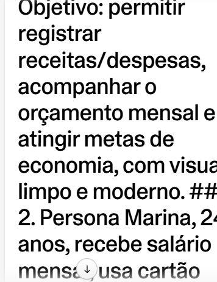

# 💰 FinançasIA — App de Organização de Finanças Pessoais com Vibe Coding

> Projeto desenvolvido para o desafio **"Criando um APP de Organização de Finanças Pessoais com Vibe Coding"** do bootcamp Santander x DIO, usando **GitHub Copilot** e **Lovable**.

---

## 📌 Resumo do Conceito

O **FinançasIA** é um aplicativo web que ajuda pessoas a organizar o dinheiro de forma simples, visual e sem planilhas complicadas.

**Problema:** muita gente não sabe para onde o dinheiro vai no fim do mês e desiste de controlar as finanças porque as ferramentas são complexas.

**Solução:** um app com cadastro rápido de receitas e despesas, categorias automáticas, metas de economia e um painel visual com dicas geradas por IA.

**Principais funcionalidades**

- ➕ Cadastro rápido de receitas e despesas (valor, categoria, data, descrição)
- 🗂️ Categorias (Moradia, Alimentação, Transporte, Lazer, Saúde, Educação, Outros)
- 📊 Dashboard com saldo do mês, gráfico por categoria e evolução mensal
- 🎯 Metas de economia com barra de progresso
- 🚨 Orçamento por categoria com alerta ao chegar em 80% e 100% do limite
- 💡 Dicas de economia geradas por IA com base nos gastos do usuário
- 🌙 Modo claro/escuro e layout responsivo (mobile-first)

**Público-alvo:** jovens adultos e iniciantes em educação financeira.

---

## 🧾 Prompt Final (PRD) usado com a IA

Este é o Product Requirement Document otimizado, usado como prompt no Lovable:

```text
# PRD — FinaçasIA

## 1. Contexto e Objetivo
Crie um aplicativo web responsivo (mobile-first) de organização de finanças
pessoais, voltado a jovens adultos iniciantes em educação financeira.
Objetivo: permitir registrar receitas/despesas, acompanhar o orçamento
mensal e atingir metas de economia, com visual limpo e moderno.

## 2. Persona
Marina, 24 anos, recebe salário mensal, usa cartão de crédito e nunca
conseguiu manter uma planilha. Quer entender para onde o dinheiro vai
em menos de 1 minuto por dia.

## 3. Requisitos Funcionais
RF01. Cadastrar transação: tipo (receita/despesa), valor, categoria,
      data, descrição opcional.
RF02. Listar transações com filtro por mês, categoria e tipo; permitir
      editar e excluir.
RF03. Dashboard com: saldo atual, total de receitas, total de despesas,
      gráfico de pizza por categoria e gráfico de barras dos últimos
      6 meses.
RF04. Orçamento por categoria: definir limite mensal e exibir barra de
      progresso; alertar visualmente em 80% (amarelo) e 100% (vermelho).
RF05. Metas de economia: nome, valor-alvo, prazo e valor já guardado,
      com percentual de progresso.
RF06. Seção "Dicas da IA": com base nos gastos do mês, exibir 3 dicas
      práticas de economia (texto curto).
RF07. Alternar tema claro/escuro.

## 4. Requisitos Não Funcionais
- Interface em português do Brasil, valores em R$ (formato 1.234,56).
- Responsivo e acessível (contraste adequado, labels em formulários).
- Dados persistidos (localStorage ou backend simples).
- Carregamento rápido e feedback visual (toasts) nas ações.

## 5. Design
- Estilo: minimalista, cantos arredondados, bastante espaço em branco.
- Cores: verde (receita), vermelho (despesa), roxo como cor primária.
- Componentes: cards, gráficos, barras de progresso, modal de cadastro.
- Navegação: barra inferior no mobile; menu lateral no desktop.

## 6. Telas
1. Dashboard  2. Transações  3. Orçamentos  4. Metas  5. Dicas da IA

## 7. Critérios de Aceite
- Adicionar uma despesa atualiza saldo e gráficos imediatamente.
- Ao ultrapassar 100% do limite de uma categoria, o card fica vermelho.
- O app funciona bem em telas de 360px de largura.

## 8. Fora do Escopo (v1)
Integração bancária, multiusuário e exportação para PDF.
```

### 🔧 Evolução dos prompts

| Etapa | Prompt inicial | Problema | Prompt otimizado |
|-------|----------------|----------|------------------|
| 1 | "Crie um app de finanças pessoais" | Genérico demais, resultado sem foco | Adicionei persona, objetivo e público-alvo |
| 2 | "Adicione gráficos" | A IA escolheu gráficos pouco úteis | Especifiquei: pizza por categoria + barras dos 6 meses |
| 3 | "Deixe bonito" | Visual inconsistente | Defini paleta, estilo e componentes no PRD |
| 4 | "Adicione alertas" | Alertas sem regra clara | Defini limites de 80% e 100% com cores |

---

## 🖼️ Interações com o Copilot / Lovable

> 📌 **Substitua pelos seus prints/vídeos** (pasta `/imagens` do repositório).

### Geração do PRD com o Copilot


### Primeira versão gerada no Lovable


### Ajustes e refinamento de prompts


### Resultado final (Dashboard)


🎥 **Vídeo da interação:** [adicione aqui o link, se tiver]

🔗 **App publicado:** [https://planos-financas-dia-adia.lovable.app]

---

## 🧠 Reflexão sobre o que aprendi

Durante este desafio percebi que **a qualidade do resultado depende diretamente da qualidade do prompt**. Quando pedi algo genérico, a IA devolveu algo genérico; quando escrevi um PRD com persona, requisitos, design e critérios de aceite, o Lovable entregou uma primeira versão muito mais próxima do que eu imaginava.

Principais aprendizados:

1. **Pensar como product manager:** antes de programar, definir problema, público e escopo faz toda a diferença.
2. **Iterar em pequenos passos:** pedir uma mudança por vez deu resultados melhores do que pedir tudo de uma vez.
3. **Ser específico:** em vez de "deixe bonito", informar cores, estilo e componentes.
4. **Revisar sempre:** a IA acelera muito, mas ainda é preciso testar, validar regras (como os alertas de orçamento) e ajustar detalhes.
5. **Comunicação é uma habilidade técnica:** escrever bem o que se quer é tão importante quanto saber codar.

Vibe coding não substitui o conhecimento técnico, mas **amplia a velocidade de prototipação** e permite validar ideias em horas, não semanas. Pretendo usar essa abordagem em projetos futuros e continuar evoluindo o app (integração bancária, multiusuário e exportação de relatórios).

---

## 🛠️ Tecnologias e Ferramentas

- **GitHub Copilot** — criação e otimização do PRD
- **Lovable** — geração do app a partir dos prompts
- **GitHub** — versionamento e portfólio

## 🚀 Próximos Passos

- [ ] Integração com Open Finance
- [ ] Login e múltiplos usuários
- [ ] Exportar relatórios em PDF/CSV
- [ ] Notificações de vencimento de contas

---

👤 **Autor:** *Alexandre Gustavo da Silva do Nascimentoi* · [LinkedIn](https://www.linkedin.com/) · [GitHub](https://github.com/)
